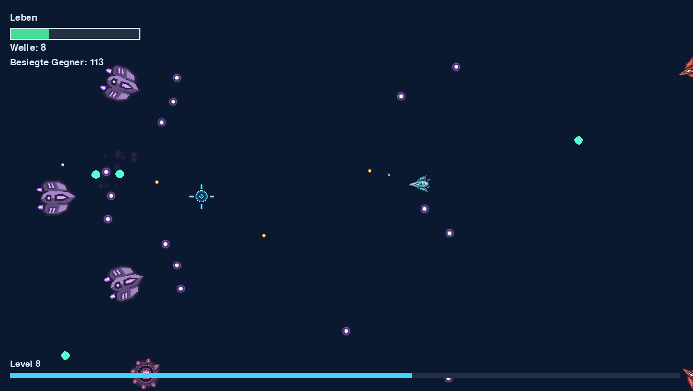

# Wellenbrecher

Wellenbrecher ist ein 2D-Survival-Roguelite im Weltraum, in dem du Gegnerwellen überlebst, Kristalle sammelst und dein Raumschiff mit zufälligen Upgrades verstärkst.



## Spielmodi

- **Classic:** Überlebe die Wellen und besiege das Mutterschiff in Welle 5; deine schnellste gewonnene Runde wird gespeichert.
- **Endless:** Halte möglichst lange durch; alle 15 Wellen erscheint ein Boss. Besiegte Gegner und vollständig geschaffte Wellen werden als unabhängige Bestwerte gespeichert.

## Steuerung

| Taste / Eingabe | Aktion |
| --- | --- |
| **W, A, S, D** | Raumschiff bewegen |
| **Maus bewegen** | Zielen |
| **Linke Maustaste halten** | Schießen |
| **Linksklick** | Menüpunkt oder Upgrade-Karte auswählen |
| **F11** | Zwischen Fenster und Vollbild wechseln |
| **R** | Nach Game Over oder Sieg eine neue Runde im gewählten Modus starten |
| **Esc** | Bei Game Over zum Hauptmenü zurückkehren; in den anderen Zuständen das Spiel beenden |

Kristalle geben Erfahrung und werden innerhalb deines Magnetradius angezogen. Beim Levelaufstieg pausiert die Spielwelt, bis du eine Upgrade-Karte auswählst. Verbesserungen gelten nur für die aktuelle Runde.

## Installation

Voraussetzungen: eine installierte Python-3-Version mit `pip` sowie Git, wenn du das Repository klonen möchtest. Das Spiel verwendet **pygame-ce**; das Modul wird im Code als `pygame` importiert.

### Windows (PowerShell)

```powershell
git clone https://github.com/AndreasReinert/Wellenbrecher.git
cd Wellenbrecher
python -m venv .venv
.\.venv\Scripts\Activate.ps1
python -m pip install -r requirements.txt
```

Falls du das Projekt und eine `.venv` bereits eingerichtet hast, öffne den Projektordner und führe nur die Aktivierung und die Installation der Abhängigkeiten aus.

Sollte PowerShell die Aktivierung blockieren, kannst du ohne Aktivierung installieren und starten:

```powershell
.\.venv\Scripts\python.exe -m pip install -r requirements.txt
.\.venv\Scripts\python.exe main.py
```

### Linux / macOS

```bash
git clone https://github.com/AndreasReinert/Wellenbrecher.git
cd Wellenbrecher
python3 -m venv .venv
source .venv/bin/activate
python -m pip install -r requirements.txt
```

Die Datei `requirements.txt` enthält:

```text
pygame-ce
```

## Start

Führe im Projektordner bei aktivierter virtueller Umgebung aus:

```bash
python main.py
```

Wähle im Hauptmenü **Spielen** und anschließend **Classic** oder **Endless**.

Bilder liegen unter `assets/bilder/`, Sounds unter `assets/sounds/`. Fehlende Bilder werden durch Ersatzformen dargestellt; ohne Sounddateien oder Audiogerät läuft das Spiel ohne Ton weiter. Highscores werden separat im Benutzerordner unter `.wellenbrecher/highscore.json` gespeichert.

Die Retro-Sounds lassen sich bei Bedarf neu erzeugen:

```bash
python tools/sounds_erzeugen.py
```

## Verwendete Werkzeuge

- **Python** – Spiellogik und Hilfsskripte.
- **pygame-ce** – Grafik, Eingaben, Spielschleife und Soundausgabe.
- **Python-Standardbibliothek** – unter anderem WAV-Sounderzeugung und Speicherung der Highscores als JSON.
- **venv und pip** – isolierte Entwicklungsumgebung und Installation der Abhängigkeiten.
- **Visual Studio Code** – Bearbeiten und Ausführen des Codes.
- **Git und GitHub** – Versionsverwaltung und Projektablage.
- **KI-Unterstützung** – Unterstützung bei Code, Grafiken und Dokumentation.

## Was ich gelernt habe
